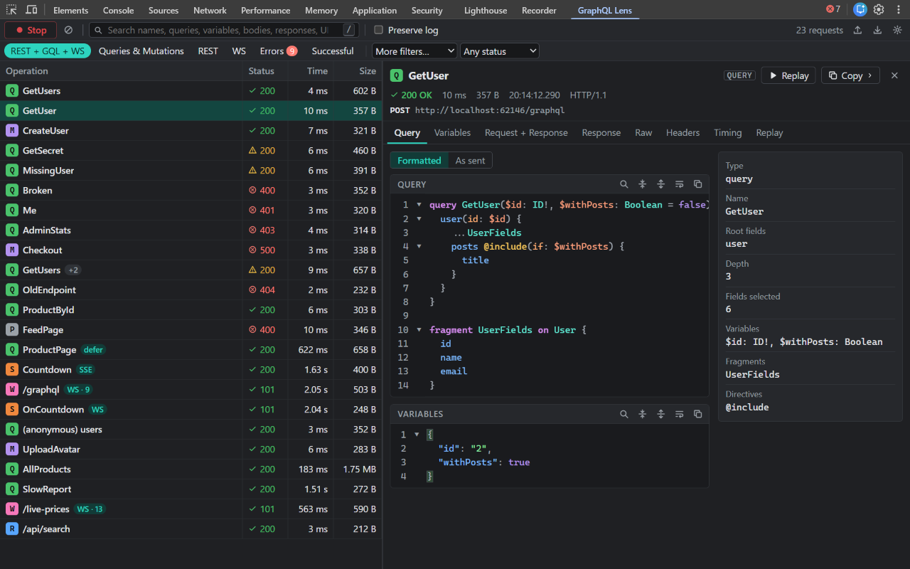
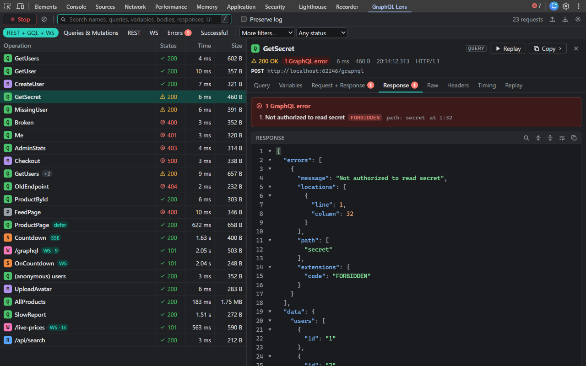
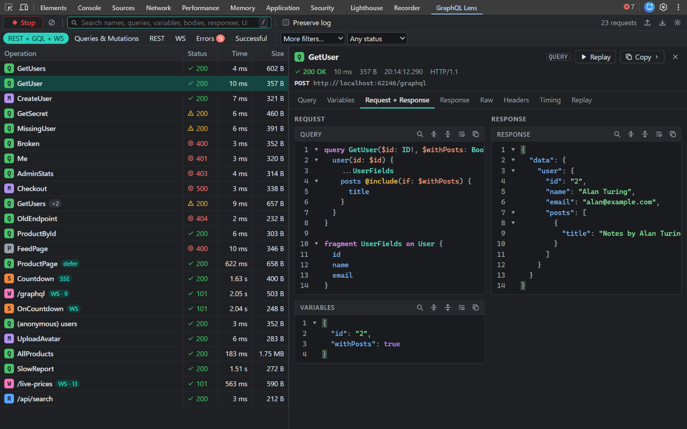
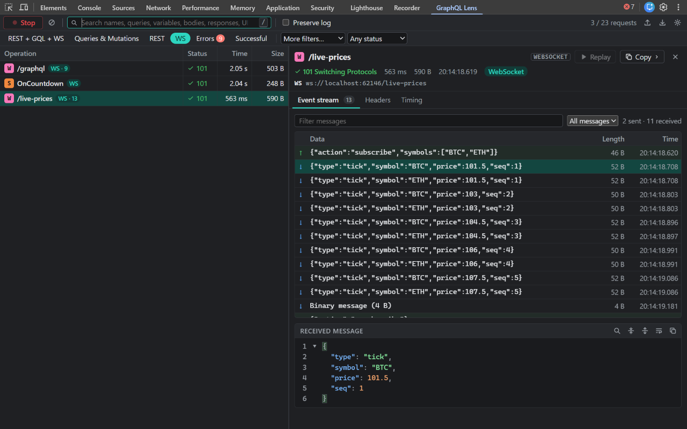
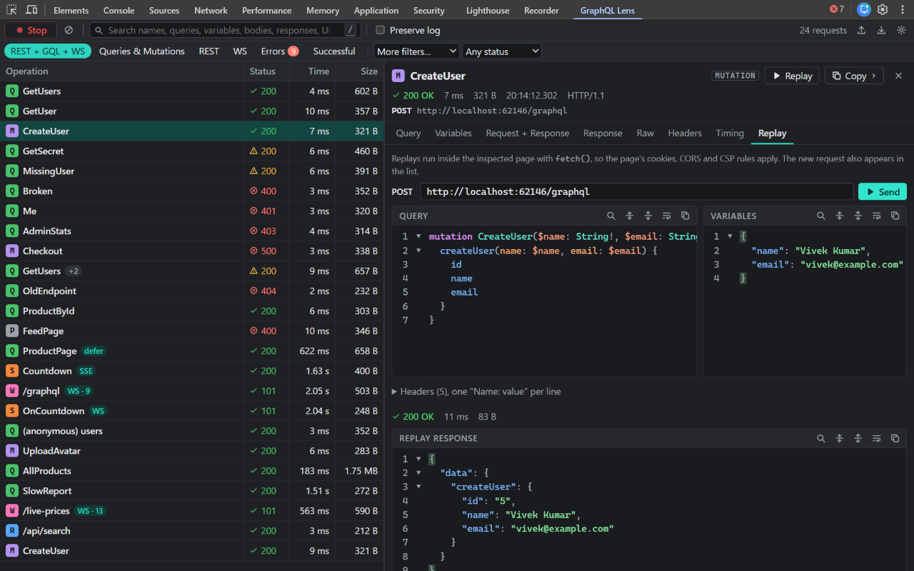

# GraphQL Lens

**Inspect. Debug. Understand GraphQL, REST & WebSocket traffic.**

GraphQL Lens adds an API panel to Chrome and Edge DevTools. Every GraphQL query, mutation and subscription the page sends shows up as its own row, named after its operation, with the query, variables, response, errors, headers and timing one click away. Plain REST calls (fetch/XHR) are listed right next to them with an **R** badge, and every WebSocket connection with a **W** badge and an event stream of its messages, so one panel shows every API call the page makes. No more digging through a wall of identical `POST /graphql` rows in the Network panel.



## Features

**Capture**

- Detects GraphQL by **payload, not URL**: POST JSON, GET query strings, `application/graphql`, form-urlencoded, multipart file uploads ([spec](https://github.com/jaydenseric/graphql-multipart-request-spec)) and automatic persisted queries (hash-only requests).
- **REST calls too**: every other fetch/XHR request is listed as **REST** (badge **R**) with its query parameters, request body, response, headers and timing. A JSON API that merely has a `query` field is REST, not GraphQL. Turn it off in ⚙ Settings → _Capture REST API calls_ for a GraphQL-only list.
- **Batching**: one request with several operations is shown as a batch, each operation collapsible, with errors attributed to the right operation.
- **Streaming**: GraphQL over **server-sent events**, **WebSocket** (`graphql-transport-ws` and the legacy `subscriptions-transport-ws`) and **`@defer` / `@stream`** multipart responses, shown as an event list (_Initial response_, _Deferred response #1_, …).
- **WebSockets**: every socket (GraphQL or not) gets a row with an **Event stream** tab listing each sent ↑ and received ↓ message with its time and size. Filter messages, and click one to see it as formatted JSON (binary frames are shown as base64). GraphQL subscriptions on a socket also get their own **S** rows.
- Requests made before the panel was opened are picked up from DevTools' network log.

**Inspect**

- Query viewer with syntax highlighting, line numbers, folding, in-editor search (Ctrl+F) and line wrapping, using CodeMirror 6.
- _Formatted_ (canonical reprint) or _As sent_ view of each query, with the **variables shown right under the query**.
- **Request + Response** tab: what was sent and what came back, side by side (stacked when the pane is narrow).
- Operation structure from the reference `graphql` parser: type, name, root fields (with aliases), depth, number of fields selected, variable definitions, fragments and directives.
- Variables tab compares **declared** variables with the **sent** values and flags missing required ones.
- Response viewer with collapsible JSON and a **GraphQL errors** summary: message, `extensions.code`, path and location.
- Raw response and request body, request/response headers, and a timing waterfall (queueing, DNS, connect, TLS, send, server wait, download).
- Status is always shown as icon + text (`✓ 200 OK`, `⚠ 200 · 1 GraphQL error`, `⊗ 500 Internal Server Error`), never colour alone.

**Act**

- **Edit & replay**: change the query, variables or headers and resend from inside the page, so its own cookies, CORS and CSP rules apply.
- **Copy** query, variables, **query + variables** together (as a GraphQL request body), response, request body, **authorization token** (the `Authorization` value without `Bearer`), URL, operation name, **cURL** or **`fetch()`**. Credentials are redacted unless you explicitly confirm.
- **Export** one request, a multi-selection, the filtered list or everything as **HAR 1.2** or readable **GraphQL JSON**, with credentials redacted by default.
- **Import** any HAR file (from Chrome, Edge, Firefox or a bug report) and inspect its GraphQL and REST traffic offline.

**Find**

- Global search across operation names, queries, variables, request bodies, response bodies, WebSocket messages and URLs (debounced, case-insensitive).
- Filters: **REST + GQL + WS** (everything) / **Queries & Mutations** (tell them apart by the **Q** and **M** badges) / REST / WS / Errors / Successful. The **More filters** dropdown adds Subscriptions, Persisted queries, Batched requests and Slow (over 1 s). Plus HTTP 2xx / 3xx / 4xx / 5xx.
- The **Stop** / **Record** button pauses and resumes capture (`Ctrl+E`).
- Record/pause, preserve log across reloads, clear.

**Built to be fast**

- Virtualized request list: only visible rows are in the DOM (measured: 500 requests, ~16 ms/frame while scrolling).
- Large responses are parsed and pretty-printed in a Web Worker, off the UI thread.
- Bounded history (default 500 requests, configurable) and a maximum response size, so memory can't grow without limit.
- The code viewer is lazy-loaded, so the panel opens instantly.

**Comfortable**

- Light, dark, or follow DevTools/system.
- Keyboard: `/` or `Ctrl+F` search · `Esc` clear search / close details · `↑ ↓ PgUp PgDn Home End` move · `Ctrl/⌘+click` and `Shift+click` multi-select · `Delete` remove · `Ctrl/⌘+C` copy query (URL for REST and WebSocket rows) · `Ctrl+E` record/pause.
- Resizable split view that adapts to narrow DevTools windows.

| Errors                                                    | Request + Response                                                       | WebSocket event stream                                                 | Replay                                           |
| --------------------------------------------------------- | ------------------------------------------------------------------------ | ---------------------------------------------------------------------- | ------------------------------------------------ |
|  |  |  |  |

## Install

Tested in **Google Chrome** and **Microsoft Edge** (version 125 or newer). Other Chromium browsers such as Brave, Opera and Vivaldi use the same extension APIs and should work the same way, but they haven't been tested.

### Option 1: Download the ready-made build (no coding needed)

1. Go to the [**latest release**](https://github.com/vivekkumarq/graphql-lens/releases/latest) and download **`graphql-lens-<version>.zip`**.
2. Unzip it. On Windows, right-click → **Extract All…**; on macOS, double-click it. You get a folder that contains `manifest.json`.
   Keep this folder somewhere permanent, such as `Documents\graphql-lens`. The browser loads the extension from it, so deleting or moving the folder removes the extension.
3. Open the extensions page:
   - **Chrome / Brave / Vivaldi:** type `chrome://extensions` in the address bar and press Enter.
   - **Edge:** type `edge://extensions` and press Enter.
4. Turn on **Developer mode**. In Chrome it's the switch at the top right; in Edge it's in the left sidebar.
5. Click **Load unpacked** and select the unzipped folder (the one with `manifest.json` directly inside it).
6. **GraphQL Lens** now appears in the list. If DevTools was already open in any tab, close and reopen it.

> Chrome may show a "Disable developer mode extensions" banner on startup. That is normal for extensions loaded this way; click **Keep** (or just close the banner). Installing from the Chrome Web Store, once it's published there, avoids it.

### Option 2: Build from source

Requires [Node.js](https://nodejs.org) 22 or newer and Git.

```bash
git clone https://github.com/vivekkumarq/graphql-lens.git
cd graphql-lens
npm install
npm run build
```

Then follow steps 3–6 above and select the **`dist`** folder inside the project.

### Updating

- **Release zip:** download the new zip, replace the contents of your folder with the new files, then click the **⟳ reload** icon on the GraphQL Lens card at `chrome://extensions`.
- **From source:** `git pull && npm install && npm run build`, then click **⟳ reload** on the card.

Reopen DevTools afterwards.

### Uninstalling

Click **Remove** on the GraphQL Lens card at `chrome://extensions` (or `edge://extensions`).

## How to use it

1. Open the website you want to inspect: your own app, `localhost`, or any site that calls a GraphQL, REST or WebSocket API.
2. Open DevTools: press **F12**, or **Ctrl+Shift+I** (Windows/Linux) / **⌘⌥I** (macOS), or right-click the page → **Inspect**.
3. Click the **GraphQL Lens** tab in the DevTools tab bar. If you don't see it, click **»** at the end of the tab bar; drag the tab to the left to keep it visible.
4. **Reload the page** (F5). Browsers only record network traffic while DevTools is open, so requests sent before you opened DevTools can't be shown. Anything sent while DevTools is open is captured, even if you were on a different DevTools tab at the time.
5. Use the page normally. Every GraphQL operation, REST call and WebSocket appears as a row:
   - Badge **Q** query, **M** mutation, **S** subscription, **P** persisted query (only a hash was sent, so the type is unknown), **R** REST call (named after its path, method in the URL column), **W** WebSocket connection (**WS · N** = N messages so far).
   - **+N** means a batch of N+1 operations in one HTTP request; **WS**, **SSE** and **defer** mark streamed responses.
   - Status shows `✓` success, `⚠` HTTP OK but with GraphQL errors, `⊗` HTTP error or network failure.
6. Click a row to see its tabs: **Query** (with structure), **Variables**, **Response** (errors on top), **Raw**, **Headers** (credentials masked, eye icon to reveal), **Timing**, and **Replay**. REST calls show **Request** (query parameters and body) in place of Query and Variables. **Request + Response** shows both sides at once. WebSockets show **Event stream**, Headers and Timing.
7. Use the toolbar to search (press `/`), filter by type, errors or HTTP status, keep requests across reloads (**Preserve log**), pause recording (**Stop** button or `Ctrl+E`), clear, import or export HAR files, and open ⚙ **Settings**.

### Troubleshooting

| Problem                                     | Fix                                                                                                                                                                                                                                                                          |
| ------------------------------------------- | ---------------------------------------------------------------------------------------------------------------------------------------------------------------------------------------------------------------------------------------------------------------------------- |
| No **GraphQL Lens** tab in DevTools         | Close and reopen DevTools after installing. Check **»** at the end of the tab bar. Make sure the extension is switched on at `chrome://extensions`.                                                                                                                          |
| The panel is empty                          | Reload the page with DevTools open. Check that recording isn't paused (red ● in the toolbar), that no search text or filter is active (**REST + GQL + WS** selected, "More filters…" and "Any status"), and that the page really calls an API (look in the **Network** tab). |
| My requests disappear when the page reloads | Tick **Preserve log** in the toolbar.                                                                                                                                                                                                                                        |
| A local `file://` page isn't inspected      | At `chrome://extensions` → GraphQL Lens → **Details**, turn on **Allow access to file URLs**.                                                                                                                                                                                |
| Replay fails with "Failed to fetch"         | The replay runs inside the page, so the page's CORS and Content-Security-Policy rules apply. The message explains which one probably blocked it.                                                                                                                             |
| WebSocket subscription events show up late  | WebSocket frames are refreshed every 2 seconds while the panel is visible.                                                                                                                                                                                                   |
| A response says it was truncated            | Raise **Maximum response size** in ⚙ Settings (default 10 MB).                                                                                                                                                                                                               |
| The panel is too narrow                     | Drag the divider between the list and the details, or dock DevTools to the bottom (⋮ menu → Dock side).                                                                                                                                                                      |

## Try it without a real API

```bash
npm run demo        # http://localhost:4000
```

The demo app has a button for every scenario: query, variables + fragments + directives, mutation, GraphQL errors, malformed query, HTTP 401/403/404/500, batching, GET, persisted query, `@defer`, SSE and WebSocket subscriptions, file upload, `application/graphql`, a ~2 MB response, a slow query, a 100-request burst, a plain (non-GraphQL) WebSocket price feed with a binary frame, and a REST JSON API (with a `query` field) that must be listed as REST, not GraphQL.

For a real public API, `node scripts/e2e.mjs chrome --real` also queries the public [Countries API](https://countries.trevorblades.com/) and checks the capture.

## Tested on

Every release is checked with two automated suites that run the extension in real browsers.

- **`npm run e2e` / `npm run e2e:edge`**: 41 checks against the bundled demo app plus the public Countries API. They cover capture (including requests sent before the panel was opened), detection, every filter and search field, every tab, replay, copy, HAR export/import, settings, keyboard shortcuts, reload behaviour, and a 500-request burst.
- **`npm run sites`**: opens real websites that use GraphQL and renders every captured request in every tab:

| Site                        | What it exercises                        | Chrome 156 | Edge 156 |
| --------------------------- | ---------------------------------------- | ---------- | -------- |
| twitch.tv                   | batched **persisted queries**, mutations | ✓          | ✓        |
| anilist.co                  | anonymous queries, an HTTP 401           | ✓          | ✓        |
| gitlab.com                  | named queries                            | ✓          | ✓        |
| rickandmortyapi.com/graphql | large introspection response             | ✓          | ✓        |
| countries.trevorblades.com  | introspection, public API                | ✓          | ✓        |

## Development

```bash
npm run dev          # rebuild dist/ on save; then close and reopen DevTools
npm test             # unit tests (Vitest)
npm run lint         # ESLint (typescript-eslint strict + react-hooks)
npm run typecheck
npm run e2e          # real-browser test in Chrome (39 checks against the demo app)
npm run e2e:edge     # the same in Microsoft Edge
npm run sites        # smoke test on real GraphQL websites (Twitch, AniList, GitLab, …)
npm run screenshots  # regenerate store-assets/ (1280×800 screenshots + promo tiles)
npm run package      # release/graphql-lens-<version>.zip for store upload
```

The end-to-end test loads `dist/` as an unpacked extension into a throwaway browser profile with `puppeteer-core`, opens DevTools on the demo app, switches to the panel and checks capture, detection, filters, search, every tab, replay, copy, export/import, settings, keyboard shortcuts, reload behaviour and a 500-request burst. It uses your installed Chrome or Edge; set `BROWSER_PATH` to point elsewhere.

**Hot reload:** Vite's dev server can't inject into DevTools panels, so `npm run dev` is a watch build. After a rebuild, close and reopen DevTools. If you changed `manifest.json`, press reload on `chrome://extensions`.

## Architecture

```
chrome.devtools.network ──► network/capture.ts ──► graphql/detector.ts ──► graphql/operation-parser.ts
  (getHAR, onRequestFinished,     │  (HAR → model)       (is it GraphQL?)        (reference graphql parser)
   onNavigated)                   │
                                  ├─► network/websocket.ts + graphql/subscription-parser.ts  (WS frames)
                                  └─► workers/analyzer.ts ─► Web Worker ─► graphql/response-parser.ts
                                                                          (JSON · batch · multipart · SSE)
                                  ▼
                     panel/store/requests-store.ts   (bounded, framework-free, useSyncExternalStore)
                                  ▼
                     panel/App.tsx ─► Toolbar · RequestList (virtualized) · RequestDetails (tabs)
```

| Folder        | Responsibility                                                               | Talks to Chrome?               |
| ------------- | ---------------------------------------------------------------------------- | ------------------------------ |
| `src/network` | HAR → `GraphQLRequest`, live capture, WebSocket frames, body decoding        | yes (`capture.ts` only)        |
| `src/graphql` | detection, parsing, formatting, response/stream parsing                      | no, pure and unit-tested       |
| `src/export`  | cURL, `fetch()`, HAR and JSON export, HAR import                             | no                             |
| `src/replay`  | builds the replay script; runs it via `inspectedWindow.eval`                 | yes                            |
| `src/storage` | settings (`chrome.storage.local`), opt-in history (`chrome.storage.session`) | yes                            |
| `src/workers` | off-thread response parsing with an inline fallback                          | no                             |
| `src/panel`   | React UI only                                                                | only through the modules above |

Key decisions:

- **No background service worker and no host permissions.** Everything the panel needs comes from `chrome.devtools.*`. The only permission is `storage`, for settings.
- **Replay runs in the inspected page** (`chrome.devtools.inspectedWindow.eval` + `fetch`). It behaves exactly like the page's own requests and never sidesteps CORS or CSP. A failure explains why (CORS, CSP `connect-src`, mixed content, network).
- **WebSocket frames** are only exposed to extensions through `getHAR()`'s `_webSocketMessages`, so the panel polls it every 2 s while it is visible.
- **Name and version have one home each.** The product name lives in `public/_locales/en/messages.json` (rename there). The version comes from `package.json` and is written into the manifest at build time.

## Limitations

- REST capture lists fetch/XHR calls only. Page loads, scripts, styles, images and fonts are left to the Network panel.
- DevTools must be open for traffic to be recorded. This is a browser rule for every DevTools extension. Reload the page to capture its initial requests.
- SSE and `@defer` responses appear when the stream finishes. Chrome gives extensions the body only once the request completes.
- WebSocket messages update about every 2 seconds (polling), and frames sent before DevTools opened are not available. The latest 2,000 messages per socket are kept.
- Replay can't resend WebSocket subscriptions or multipart file uploads with their original files. Headers that page scripts may not set (`Cookie`, `Origin`, `User-Agent`, `Sec-*`) are dropped; the browser adds its own.
- Response bodies larger than the configured limit (10 MB by default) are truncated and shown raw.
- "Formatted" queries are reprinted by the reference printer, which drops comments. Use _As sent_ to see the original.

## Privacy

GraphQL Lens has **no analytics, no telemetry and no servers**. Captured traffic lives in the memory of your DevTools window and disappears when you close it. The optional "keep requests when DevTools closes" setting uses `chrome.storage.session`, which is in memory and cleared when the browser quits. Nothing is ever sent anywhere. See [PRIVACY.md](PRIVACY.md).

## Security

All network content is treated as untrusted. It is rendered only as text (React text nodes and CodeMirror documents), never as HTML, and never evaluated. The replay script embeds captured values with `JSON.stringify`, so they can't break out of string literals (covered by a unit test). Credentials are masked in the UI and redacted in cURL, `fetch()` and exports unless you explicitly opt in.

## Publishing

See [STORE_LISTING.md](STORE_LISTING.md) for the listing text, permission justifications, privacy answers and asset checklist for the Chrome Web Store and Microsoft Edge Add-ons.

**Versioning:** [SemVer](https://semver.org). Bump with `npm version patch|minor|major`; the build copies the version into the manifest. Every store upload needs a higher version than the last one.

## Roadmap

- Schema-aware features: fetch the schema via introspection (opt-in) and show field types and docs on hover.
- Diff two requests or two responses.
- Response time chart per operation.
- Firefox support (its DevTools API differs in a few places).

## Contributing

Issues and PRs are welcome. Please run `npm run release` (lint + unit tests + package) and `npm run e2e` before opening a PR.

## License

[MIT](LICENSE) © Vivek Kumar
